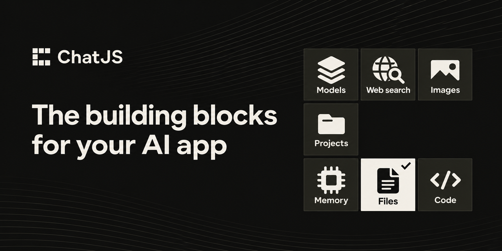

<div align="center">

<picture>
  <source media="(prefers-color-scheme: dark)" srcset="packages/brand/assets/social/github-dark.png">
  <source media="(prefers-color-scheme: light)" srcset="packages/brand/assets/social/github-white.png">
  
</picture>

# ChatJS

**The building blocks for your AI app.**

Start with a working AI chat. Choose your models and tools. Own the code.

[**Create an app**](https://www.chatjs.dev/create) · [**Try the demo**](https://demo.chatjs.dev) · [**Read the docs**](https://www.chatjs.dev/docs)

</div>

> **ChatJS 1.0 is in alpha.** Use `chat-js@alpha` to try it. APIs, configuration, and generated code may change before the stable release.

## Quickstart

Use Node.js 24 or newer. You can scaffold interactively from the terminal. The browser builder lets you preview the UI, configure the agent, and copy a tailored command. [Open the builder](https://www.chatjs.dev/create)

```sh
npx chat-js@alpha create my-app
cd my-app
cp .env.example .env.local
```

The CLI asks which gateway, authentication providers, and optional features to include. Fill in `.env.local` with your PostgreSQL connection, gateway and authentication credentials, and any settings required by your selections. Generate `AUTH_SECRET` and `EVE_GATEWAY_SECRET` separately with `openssl rand -base64 32`. [Full setup guide](https://www.chatjs.dev/docs/quickstart)

```sh
npm run setup
npm run dev
```

The setup command applies app migrations and prepares EVE's workflow database. Open [localhost:3000](http://localhost:3000) to sign in and send your first message.

## What you get

- **A working chat app.** Next.js, TypeScript, and shadcn/ui with streaming responses, saved conversations, and Better Auth. Scaffold with Base UI or Radix.
- **A durable agent runtime.** EVE runs conversations and tools, persists execution state, handles approvals, and lets the client reconnect to an in-progress response. [Architecture](https://www.chatjs.dev/docs/core/architecture)
- **Your choice of models.** Use Vercel AI Gateway, OpenRouter, OpenAI, LiteLLM, or an OpenAI-compatible endpoint. [Gateways](https://www.chatjs.dev/docs/gateways/overview)
- **Optional capabilities.** Add uploads, projects, and sharing, or equip the agent with web search, code execution, image generation, or MCP connectors. [Tools](https://www.chatjs.dev/docs/tools/overview) · [Plugins](https://www.chatjs.dev/docs/plugins/overview)

## Make it yours

Change branding, model defaults, and app settings in `chat.config.ts`. Customize agent behavior in `agent/agent.ts`. Tools and plugins are installed as source files you can edit and commit with your app. [Source ownership](https://www.chatjs.dev/docs/core/source-ownership)

To add MCP connectors, run this from inside your app.

```sh
npx chat-js@alpha add mcp
```

Generate `MCP_ENCRYPTION_KEY` with `openssl rand -base64 32` and set it in `.env.local`. Run `npm run db:generate`, review the generated SQL, then apply it with `npm run db:migrate`. [MCP setup](https://www.chatjs.dev/docs/plugins/mcp) · [CLI reference](https://www.chatjs.dev/docs/cli)

Deploy the web app on Vercel. For self-hosting, the Docker and Node.js guides document the required services and outstanding lifecycle checks. Add the Electron companion to package your app for macOS, Windows, and Linux. [Deployment guides](https://www.chatjs.dev/docs/deployment) · [Desktop guide](https://www.chatjs.dev/docs/deployment/desktop)

## Contributing

This repository contains the [reference app](apps/chat), [site and builder](apps/site), [docs](apps/docs), [Electron companion](apps/electron), [CLI](packages/cli), and [source registry](packages/registry).

For a fresh checkout, use Node.js 24+ and Bun from the repository root.

```sh
bun install
cp apps/chat/.env.example .env.local
# Fill in the environment variables for the reference app.
bun run setup
bun dev
```

Use `bun dev:info` to find your local app URLs and `bun dev:docs` to work on the docs. For unattended local development on macOS, `bun dev:service start` registers supervision at login. Use `bun dev:health` to check readiness and `bun dev:service stop` to unregister it.

For registry changes, edit `packages/registry/src` and the relevant manifests. The development server mirrors them into `apps/chat`. Run `bun lint`, `bun test:types`, and the relevant tests before opening a PR. [Repository instructions](AGENTS.md) · [Registry development](packages/registry/DEVELOPMENT.md) · [Release process](https://www.chatjs.dev/docs/reference/desktop-releases)

## License

[Apache 2.0](LICENSE)

<a href="https://vercel.com/oss">
  
</a>
