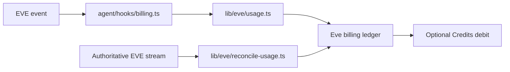

ChatJS records EVE usage as durable billing evidence. The EVE billing hook receives native events, records provider model costs and platform-tool costs with stable event identifiers, and can later reconcile from the authoritative EVE stream.

## Flow

`lib/eve/usage.ts` records model calls, completed steps, compaction usage, and supported platform-tool results. Each record uses an event-derived identity, so replaying an event does not charge it twice.

`lib/eve/reconcile-usage.ts` reads only the unprocessed suffix of the native stream and advances a durable cursor after successful reconciliation. Missing tool receipts remain eligible for replay without themselves blocking admission. Reconciliation failures can still prevent new work.

[Credits](../plugins/credits) owns balance storage. `chatjs/plugins/credits/credits-queries.ts` reads registered-user balances through `getBalanceCents`. The TypeScript field and tRPC response use `balanceCents`, while the existing database column remains `UserCredit.credits` to preserve stored balances.

Both new-conversation and follow-up-message admission call `canStartPaidTurn` in `lib/eve/spending-admission.ts`. It reconciles usage before reading the balance. Reconciliation failures propagate to the request's existing recovery response. A positive balance gate does not reserve a concurrent budget for work that has already started.

Without Credits, core still deduplicates and reconciles usage evidence, but does not create or debit balances. The installed policy commits debits in the same transaction as usage evidence and settlement markers.

The sidebar distinguishes a pending read and a failed read from a real zero balance. Completed, failed, and cancelled turns invalidate the balance query. Guests use separate rate limits and input-size limits, with no monetary or message-credit balance.

## Related

- [Native EVE Conversations](/cookbook/next-chat-transition) for runtime ownership
- [Configuration](/core/configuration) for feature and model choices
