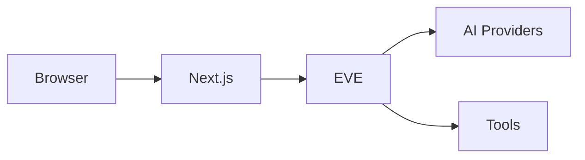
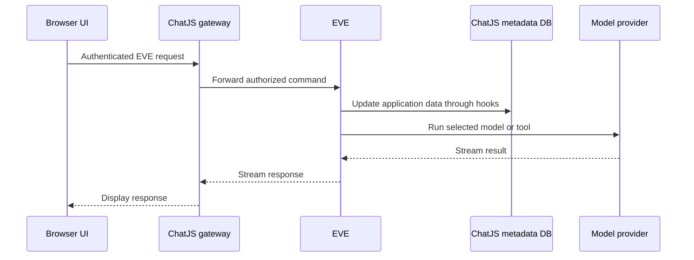

## System Overview

The current ChatJS application uses:

- **Next.js App Router** for the frontend and API routes
- **EVE** for conversation execution, message persistence, tool calls, and stream recovery
- **PostgreSQL** (via [Drizzle ORM](https://orm.drizzle.team)) for application-owned metadata such as users, ownership, projects, sharing, files, documents, and billing evidence
- **AI SDK** to connect to multiple AI providers through a [gateway abstraction](../gateways/overview)
- **Files SDK** through a configured [file storage provider](../storage) for attachments and generated media
- **tRPC** for end-to-end type-safe API routes between client and server

## EVE conversation flow

When a user sends a message:

EVE runs conversations and persists their messages and execution state. ChatJS manages authentication, chat organization, sharing, files, documents, and billing.

## Core and optional extensions

Core owns account authentication, conversation ownership, EVE execution, model resolution, and usage evidence. Installed plugins add capabilities such as Projects, Sharing, Model Preferences, and Credits. Tools and providers have separate installation contracts.

See [Configuration & Extensions](./configuration) for the available extension types and [Source Ownership](./source-ownership) for where to make changes.

## Usage evidence

Core records model and supported tool usage with stable event identifiers and reconciles it against the authoritative EVE stream. Replaying evidence does not duplicate recorded usage. This recording and reconciliation also runs without Credits installed, without creating or debiting balances. Reconciliation failures can prevent new work.

[Credits](../plugins/credits) owns balance checks and charging policy. Its page explains how recorded usage becomes a debit when the plugin is installed.
