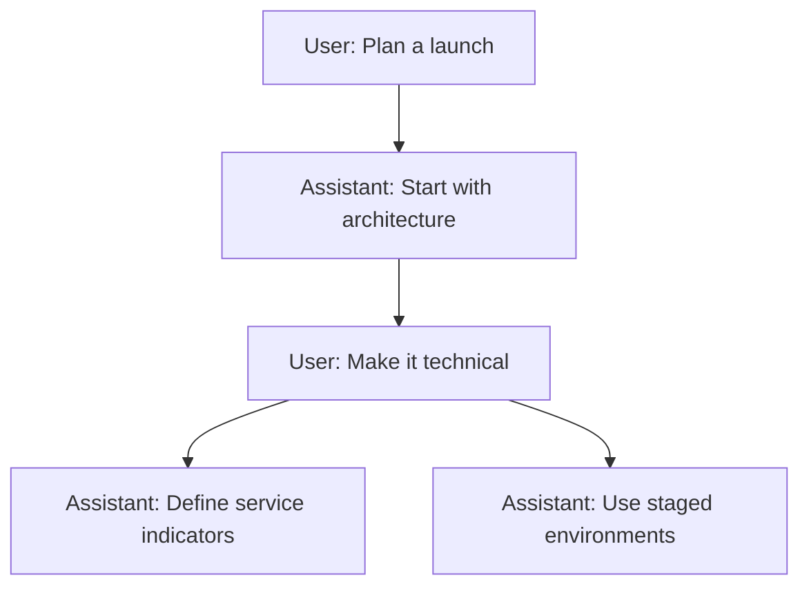
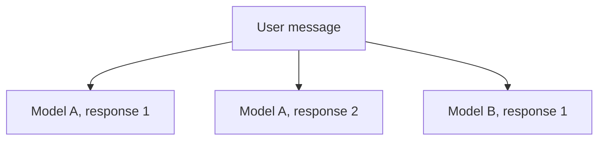

A chat groups the conversation paths you can revisit in the interface. EVE stores the native messages and execution state. ChatJS keeps ownership and application metadata around those sessions.

A user message starts a turn. An answer can include assistant output and tool calls. Editing earlier input, regenerating an answer, or comparing multiple responses creates alternative paths within the same chat.

Branching and parallel responses are core application behavior. They do not require installing a registry plugin. `features.parallelResponses` controls whether the parallel-response interface is available.

## Branching

Branching lets you explore another direction without replacing the original conversation path. Editing a message or generating another response creates a sibling that you can return to later.

<Frame>
  
</Frame>

### How it works

Every message has a parent, which forms a conversation tree. ChatJS displays one root-to-message path at a time while keeping the other branches available.

Sending a follow-up continues the selected branch. Edit an earlier user message or regenerate a response to explore an alternative path.

### Navigate branches

When a message has siblings, arrow controls show the current position, such as `2/3`. Use the arrows to move to the previous or next branch.

Switching branches:

- changes the active conversation path
- preserves responses that are still streaming on other branches
- clears transient data that belongs to the previous path
- closes an open artifact when its message is not in the selected path
- follows the selected branch to its latest descendant

### Edit a message

Editing creates a replacement branch. The original message and all of its descendants remain in the tree, so you can switch back with the same sibling controls.

### Runtime

EVE persists conversation messages and executes each branch. ChatJS keeps the branches together in one chat and displays the selected path.

## Parallel responses

Parallel responses let you request several replies to one user message. You can compare different models, ask one model for multiple alternatives, or combine both approaches in the same response group.

### Request responses

1. Open the model selector in the chat input.
2. Enable **Use Multiple Models**.
3. Select the models you want to use.
4. Set the response count for each selected model.
5. Send your message.

The total response count must be greater than one. Selecting one model with a count of three creates three independent replies from that model. Selecting three models with a count of one creates one reply from each model.

<Callout type="note">
  Parallel responses require authentication. Anonymous sessions are limited to a
  single model per request.
</Callout>

### Independent runs

EVE runs each response independently. ChatJS presents the responses together as alternatives within the same chat. Each response keeps its own streaming state and stop control.

The first response becomes the selected path. Other responses use background runs, so they continue streaming when you select another response or navigate to a different branch.

For a new chat, response cards appear while creation is in progress. ChatJS creates the chat once, then starts the remaining responses with the same context.

### Response cards

A card appears for each requested response and shows its model and current state. Select a card to make that response the active conversation path.

After selecting a response, new messages continue from that branch. The other responses remain available, including any that are still generating.

### Current constraints

- Attachments require sign-in and support for the file type in every selected model.
- Each response generates its own model usage. The optional Credits plugin applies its charging policy.
- Stopping the selected response does not stop other active runs. Select another running response to stop it separately.

## Related

- [Execution & Recovery](./execution) explains streaming, reconnecting, and cancellation.
- [Models](../customization/models) explains catalog and model defaults.
- [Standalone thread package](../threads) documents `@chat-js/thread` for other AI SDK apps. It is separate from the EVE runtime described here.
