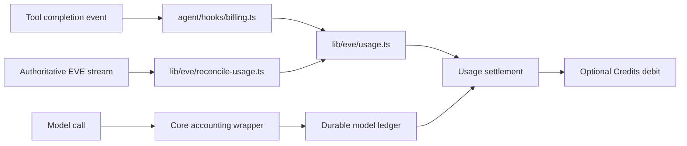

Use Credits to give registered users a starting balance, check it before paid work, and display the remaining amount in the sidebar. Core continues to record and reconcile usage with or without this plugin.

## Installation

If your existing database still needs migration 0021, plan a coordinated rollout. Older app and worker processes must stop before that migration runs.

Install the plugin and generate its schema changes in every case:

```bash
bunx chat-js@alpha add credits
bun db:generate
```

Review the generated SQL, then choose the migration command:

- For a new database, or one where migration 0021 is already applied, run `bun db:migrate`.
- For an existing database that still needs migration 0021, drain older app and worker processes, run `bun db:migrate --coordinated`, then deploy matching app and worker versions.

The CLI registers the `credits` router, billing policy, account summary, and `UserCredit` schema. The reference app already includes Credits. Extracting it preserves the existing table and data without a new migration.

## Usage

New balance rows start at **50 cents ($0.50)**. Reading the balance or checking spending availability creates a missing row. A positive usage debit also creates it if needed.

Admission first reconciles recorded usage, then requires a strictly positive balance. Recovery stays on the send path. This check does not reserve money or estimate a turn's final cost: concurrent and in-flight work can leave a negative balance. The next admission then fails.

Core sums provider costs using database decimal arithmetic, rounds up once per turn to whole cents, and subtracts only the unpaid difference. Receipt writes, the debit, and the settlement marker commit in one transaction. Replayed evidence does not charge twice. Unknown costs remain pending until reconciliation resolves them.

[Guest Chat](./guest-chat) owns disposable visitor sessions and rate limits. Guests do not enter account billing or own monetary balances. Credits does not add payments, subscriptions, top-ups, or an administrative balance editor.

## From usage to a debit



`lib/eve/usage.ts` ingests supported platform-tool receipts and registers native child sessions. Tool receipt identities use the native session and call ID. Model calls are recorded separately through the accounting wrapper in `lib/eve/model-ledger.ts` and the durable ledger in `lib/db/eve-model-ledger.ts`. The wrapper generates a unique attempt ID before each model call. Replaying a receipt for an existing identity does not debit it twice. A new model attempt has a distinct identity.

`lib/eve/reconcile-usage.ts` normally reads from the durable stream cursor. On the managed backend, scheduled reconciliation retries sessions with unpriced tool receipts from the beginning, including their child sessions. Unresolved pricing keeps replay available without itself blocking admission. An output with no recognized tool receipt is skipped rather than treated as an unpriced receipt. Other reconciliation failures can still prevent new work.

Both new-conversation and follow-up-message admission call `canStartPaidTurn` in `lib/eve/spending-admission.ts`. It reconciles usage before reading the balance. Reconciliation failures propagate to the request's recovery response. A positive balance check does not reserve a concurrent budget for work already running.

The installed billing policy commits debits in the same transaction as usage evidence and settlement markers. See [Architecture](../core/architecture#usage-evidence) for the behavior that remains without Credits.

## Storage

| Table | Fields | Purpose |
| --- | --- | --- |
| `UserCredit` | `userId`, `balanceCents` → SQL `credits` | Integer balance in cents, deleted with its user |

The TypeScript field and tRPC response use `balanceCents`. The SQL column remains `UserCredit.credits`, preserving existing balances. The sidebar shows distinct loading and error states, and refreshes when a turn completes, fails, or is cancelled.

Core retains `EveUsage`, its `chargedCents` settlement marker, receipt deduplication, and durable reconciliation cursors. The plugin owns balance storage and policy.

## Customization

- Edit `chatjs/plugins/credits/credits-schema.ts` to change the default for new balance rows, then generate and apply a migration. Existing balances stay unchanged.
- Edit `credits-queries.ts` for balance reads.
- Edit `billing.ts` for admission and debit behavior. Use the supplied database transaction; throwing rolls back the receipt and debit together. Keep external payment calls out of this operation.
- Edit `balance.tsx` and `use-credits.ts` for the sidebar display and balance refresh.

Only one installed plugin can provide billing. Its `billing.ts` entry must load in both native EVE and Next.js, without importing web routers or request helpers. See the [Plugin API](../reference/plugin-api).

## Without Credits

A new app without this plugin has no `UserCredit` table, credits router, or balance display. Spending passes the optional monetary gate, while authentication, guest rate and input/output limits, and usage reconciliation still apply.

Adding Credits does not run a historical backfill. However, a later receipt for a previously unbilled turn computes its unpaid total from all recorded evidence for that turn. Decide how to settle existing in-flight turns before enabling billing on an app that previously ran without it.
