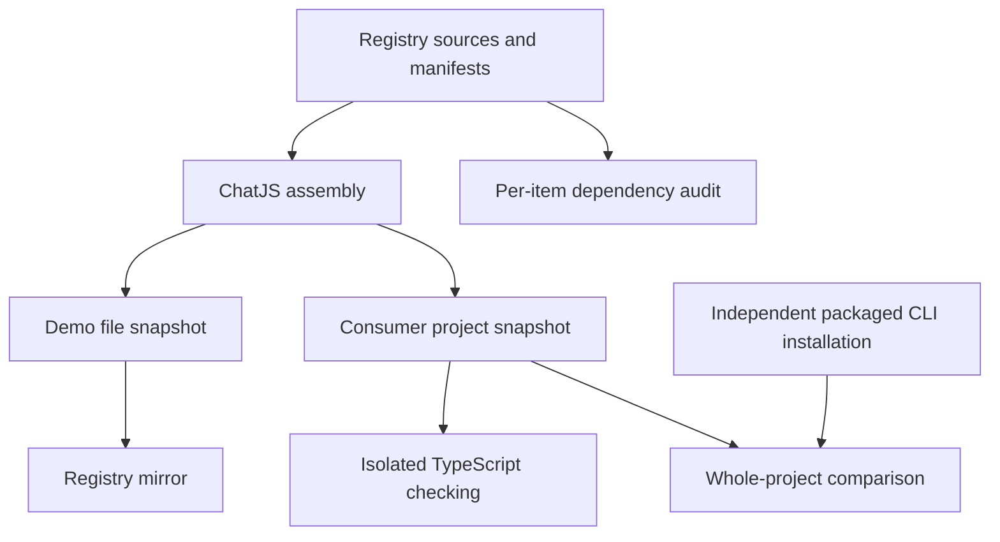

Use registry validation to check the application produced by a selection of items. You can catch missing dependency declarations, missing files and incompatible types without installing dependencies for every selection.

Run from the repository root after installing dependencies:

```bash
bun run --cwd packages/registry-validation test:unit
bun run --cwd packages/registry test:installation
bun run --cwd packages/cli test:gateways
```

The first command tests the reusable engine with an unrelated notes registry. The second checks ChatJS combinations. The third installs the packaged CLI into independent apps and verifies the real installation behavior.

## Shared sources, separate consumers

Registry manifests supply file membership, targets, dependencies and prerequisites. The ChatJS assembly module reuses the CLI planner and configuration writers. It produces a demo snapshot for [Registry Mirror](./mirror) and a consumer snapshot for validation.



The reusable `@chat-js/registry-validation` workspace package owns the compiler, dependency isolation, ownership audit, project comparison and temporary shadcn staging. It does not know ChatJS plugin kinds, gateways, registrations or demo defaults.

## What the checks prove

| Check | What you learn |
| --- | --- |
| Dependency ownership | Each item declares the packages its original source imports, except packages explicitly allowed by the host contract |
| Isolated TypeScript | The assembled files compile using declared dependencies from the prepared fixture |
| Combination matrix | Representative shared integration points and prerequisite combinations compile together |
| Real-install parity | Predicted files and real installed files agree under the declared comparison policy |
| Real installation tests | Installation, runtime imports, bundling, database generation and replacement behavior still work |

Core dependencies and inherited packages are separate contracts. A package being present in core does not let a plugin omit its declaration. For example, the negative feedback test removes `drizzle-orm` from the plugin manifest and requires rejection even though core still uses it.

## Combination coverage

The current ChatJS matrix contains 28 cases: five minimal gateways, thirteen individual plugins with their prerequisites, a tool/plugin composition, seven groups derived from shared contribution metadata, the complete reference preset and its alternative search provider.

New plugin metadata feeds the individual and shared-contribution selections. This is representative coverage, not every subset or installation order.

Real-install parity compares the complete application file inventory. It normalizes source formatting and known test registry/package URLs. Installer receipts, lockfiles, build output, incremental compiler state and timestamped migrations are excluded from parity and remain covered by their real checks. The full preset also exercises repeated sync and provider replacement.

## Performance and limits

Application compilation runs in memory. Source generation still stages a real project for shadcn because import rewriting depends on existing files. No dependency installation occurs per virtual case.

```bash
bun run --cwd packages/registry profile:validation
```

The recorded pre-extraction local profile spent about 12–14% of validation time rendering sources. This justified retaining staging. Re-run the profile when evaluating changes to the generator. The measurements and methodology are recorded in `packages/registry/VALIDATION-PROFILE.md`.

Static ownership checks do not cover computed runtime imports. A prepared dependency fixture also cannot prove fresh package resolution or incremental package-manager behavior. Real tests caught an MCP install-order issue that required an explicit core AI SDK schema-helper pin. Keep the existing runtime, database, bundling and package-manager checks described in [Building and Testing](./testing).
