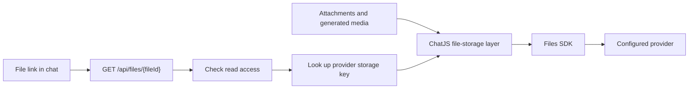

ChatJS uses [Files SDK](https://files-sdk.dev) to store files without coupling application code to one storage provider. Built-in providers use Files SDK adapters. Choose an adapter during app creation or [replace it in an existing app](#changing-providers). Uploads, generated media, downloads, cloning, and cleanup all use the selected adapter.

Durable file storage is required when you enable any of these capabilities:

- [Attachments](/plugins/attachments)
- [Image generation](/tools/generate-image)
- [Video generation](/tools/generate-video)
- [Publishing files from the agent workspace](/tools/code-execution)

<Callout type="warning">
  The in-memory adapter is suitable for projects that do not use file-backed
  features. Do not use it for persistent files in production.
</Callout>

## Choose a provider

The interactive installer asks you to choose a file storage provider when your selected features require one:

```bash
npx chat-js@alpha create my-app
```

To skip prompts, pass `--yes` along with the provider and its non-secret options.

```bash
npx chat-js@alpha create my-app --yes \
  --storage-provider s3 \
  --storage-config '{"bucket":"uploads","region":"us-east-1"}'
```

The installer derives its choices, peer dependencies, and environment hints from the Files SDK provider catalog. See the [Files SDK provider reference](https://files-sdk.dev/docs/providers) for the available providers and their configuration requirements.

The installer omits adapters that are not suitable for its generated production runtime. This includes non-persistent or development-only adapters, runtime-specific adapters such as Convex and Bun S3, and adapters whose production credentials must be embedded in constructor options. You can still integrate those adapters manually when your runtime and secret-management model support them.

<Callout type="note">
  `--storage-config` is only for non-secret adapter options such as a bucket,
  region, endpoint, or runtime binding. Keep tokens, passwords, private keys,
  and other credentials in environment variables or your provider SDK's
  credential chain.
</Callout>

You can also select a third-party registry item with a namespace, HTTPS URL, or local JSON path:

```bash
npx chat-js@alpha create my-app --yes \
  --storage-provider https://example.com/r/acme-storage.json \
  --storage-config '{"bucket":"uploads"}'
```

The external item must implement the [storage authoring contract](/storage/custom). Its identifier does not need to be in Files SDK's provider catalog.

## Installed configuration

shadcn installs the selected item source and declared dependencies. The ChatJS CLI writes typed options and environment requirements without evaluating the item.

| File | Responsibility |
| --- | --- |
| `chatjs/providers/storage.ts` | Installed source exporting `createStorageAdapter` |
| `chatjs/providers/storage-options.ts` | Typed non-secret options and environment requirements |
| `lib/file-storage.ts` | Shared upload, download, list, and delete operations |
| `.env.example` | Environment hints for the selected provider |
| `scripts/check-env.ts` | Build-time validation for provider requirements |

For example, a Vercel Blob installation generates an adapter like this:

```typescript title="chatjs/providers/storage.ts"
import { vercelBlob } from "files-sdk/vercel-blob";

export const createStorageAdapter = vercelBlob;
```

```typescript title="chatjs/providers/storage-options.ts"
import type { createStorageAdapter } from "./storage";

export const storageOptions = {} satisfies Parameters<
  typeof createStorageAdapter
>[0];
export const storageId = "vercel-blob";
export const storageEnvRequirements = [
  {
    options: [
      ["BLOB_READ_WRITE_TOKEN"],
      ["VERCEL_OIDC_TOKEN", "BLOB_STORE_ID"],
    ],
  },
];
```

Run the environment check after configuring deployment secrets:

```bash
bun run check-env
```

## How files are delivered



A saved file link has the form `/api/files/{fileId}`. The route checks read access on each request. For an authorized reader, it redirects to a short-lived signed URL when the adapter supports one, or streams the file through ChatJS. An inaccessible or unknown file with a valid ID returns 404.

The `EveStoredFile` record maps the public file ID to the provider’s `storageKey`. Files SDK adds the `<appPrefix>/files/` prefix when accessing the provider. Use that prefix and storage key when locating or copying an object.

## Credentials

Credential requirements depend on the selected provider. Built-in items derive requirements from Files SDK metadata. External items declare their own requirements. The app validates the generated requirements at build time. Some providers can also use an SDK credential chain such as an IAM role, shared profile, workload identity, or runtime binding.

Copy `.env.example` to `.env.local` for local development, then set the values generated for your provider. For deployment, use your platform's secret management instead of committing credentials.

See [Environment variables](/reference/env-vars) for the ChatJS-wide rules.

### Vercel Blob

Vercel Blob is the default durable provider for generated ChatJS apps. Connect a Blob store to your Vercel project to receive `BLOB_READ_WRITE_TOKEN` automatically, or set the token in `.env.local` for local development.

```bash
npx chat-js@alpha create my-app \
  --storage-provider vercel-blob
```

## Changing providers

<Callout type="warning">
  Before switching a deployed app, copy the referenced objects with their full
  provider keys, including the prefix. Account for uploads made during the copy,
  then verify the destination before directing traffic to it.
</Callout>

From the app directory, install the replacement adapter with its options. For example, to switch to S3:

```bash
npx chat-js@alpha add --storage-provider s3 --replace \
  --storage-config '{"bucket":"uploads","region":"us-east-1"}'
```

Configure the destination credentials and run `bun run check-env`. In a test deployment, reopen an existing attachment and upload and download a new one. The [add command](/cli/add) changes the adapter and its configuration. Object migration is a separate step.

If you are upgrading from a ChatJS version that stored Vercel Blob URLs directly, those legacy references are not migrated automatically. Keep the old Blob store available until you have copied and verified the objects and updated their database references. Delete old objects only after the migrated files have been verified.

ChatJS does not currently ship an automatic file migration command.

## Cleanup

The authenticated `/api/cron/cleanup` route considers stored objects older than four hours. It checks their ChatJS ownership records and file references before deleting eligible orphans. Objects without a matching ChatJS record are skipped. Set `CRON_SECRET` before enabling the scheduled cleanup job.

## Troubleshooting

<Accordion>
  <AccordionItem title="The environment check reports missing storage variables">
    Review the provider block generated in `.env.example`. Satisfy one complete
    credential mode, or configure the provider-supported SDK credential chain.
    Do not place credentials in `--storage-config`.
  </AccordionItem>
  <AccordionItem title="Files disappear after restarting the app">
    Your project is probably using the in-memory adapter. Configure a durable
    Files SDK provider before enabling attachments or generated media.
  </AccordionItem>
  <AccordionItem title="Existing files fail after changing providers">
    The new adapter cannot read objects that remain in the previous provider.
    Restore the previous adapter, then copy and verify the existing objects
    before switching again.
  </AccordionItem>
</Accordion>

## Related

- [Attachments](/plugins/attachments)
- [Deploy to Vercel](/deployment/vercel)
- [Environment variables](/reference/env-vars)
- [Project structure](/project-structure)
