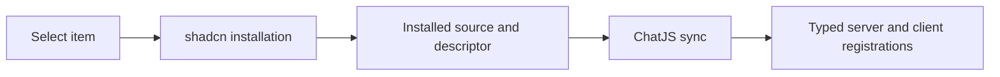

Start in a ChatJS app containing `chat.config.ts` and `components.json`.

```bash
npx chat-js@beta add deep-research --yes
```

The CLI validates the item's ChatJS metadata and existing registration outputs. shadcn installs the item, supporting registry files, and npm dependencies using your project's package manager. ChatJS then reads local descriptors and generates typed imports in `chatjs/generated/tools.ts` and `chatjs/generated/ui.ts`.



The app composes server tools in `integrations/tools/execution.ts` and client renderers in `integrations/tools/ui.ts`. The renderer registry checks the installed renderer before displaying a tool result.

## Customize and update

Edit the implementation and renderer supplied by the item. Deep Research runs from `agent/tools/deepResearch.ts`. Put additional registrations in `integrations/tools/execution.ts` and `integrations/tools/ui.ts`. Leave generated indexes to `sync`.

Repeat `add` to update an item. ChatJS checks the files against its installation record. If it finds modifications or untracked source, review the files with `chat-js status --files` before authorizing replacement with `--overwrite`.

After a direct shadcn install, or a reported registration failure, run:

```bash
npx chat-js@beta sync
```

Sync validates descriptors, duplicate installed descriptor keys, and generated-index integrity before writing registrations. Generated indexes detect collisions with custom registrations when loaded. A missing or mismatched requested descriptor is an error.

## Related

- [Tool Registry](/tools/overview) for ownership and migration
- [Tools](/tools/authoring) for building a registry item
- [CLI add](/cli/add) for command options
