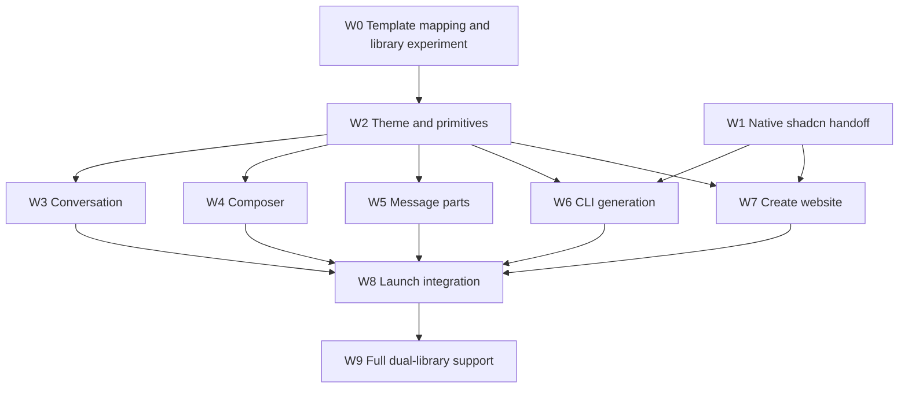

# ChatJS Create and UI modernization work map

Status: W0–W9 implementation and release QA complete, 27 October 2026. CLI `0.9.0-beta.2` and registry `0.2.0-beta.2` are public under `beta`; stable `latest` remains CLI `0.8.0` and registry `0.1.2`. Fresh public Base/Radix apps pass generation, customization preservation, types, real chat, document persistence, and desktop/mobile QA. Create is live at https://www.chatjs.dev/create and passes production Base/Radix and activity suites. PR 899 merged after all CI and visual gates passed. Post-merge release and site/docs deployments pass. The chat-app production rollout is separately blocked by its existing migration 0021 guard; an intermittent Chrome preview timeout is also recorded for follow-up. Automatic migration and OpenRouter/S3/OAuth certification remain separate follow-ups. See the [W9 release report](chatjs-w9-release-verification.md) for evidence; earlier reports retain their historical scope.

Starting point: updated `origin/main` at `9c7d39254`, branch `codex/shadcn-ui-plan`. Rebase implementation branches onto current main before starting their slices. Existing CLI scaffold work in the primary checkout must be reconciled before overlapping CLI changes.

ChatJS will adopt the official shadcn chatbot template as its reference for theme, UI structure, naming, and composition. ChatJS Create is a launch deliverable: developers customize a visual preset and select app installation options, preview the result, and receive a command that generates that configuration. The application should require fewer local modifications to upstream components.

## Agreed scope

- Use native shadcn presets and ordinary `components.json` configuration.
- Follow the chatbot template's UI and theme organization while retaining ChatJS runtime and registry ownership boundaries.
- Build a ChatJS Create website with visual preset authoring, a representative ChatJS preview, installation choices, and a reproducible CLI handoff.
- Keep the Create website and CLI aligned through shared validation, defaults, and installation metadata.
- Investigate Base UI early. Full Base UI and Radix support is a separate milestone and is not a launch prerequisite unless the initial experiment establishes that both are inexpensive to ship.
- Developer customization is in scope. Appearance settings for end users of deployed apps are outside this effort.

## Reference and current constraints

The [official chatbot template](https://github.com/shadcn-ui/chatbot-template) currently uses `base-rhea`, neutral colors, Lucide, and Geist. Its [configuration](https://github.com/shadcn-ui/chatbot-template/blob/main/components.json), [global styles](https://github.com/shadcn-ui/chatbot-template/blob/main/app/globals.css), and [layout](https://github.com/shadcn-ui/chatbot-template/blob/main/app/layout.tsx) establish the intended visual foundation. W0 records upstream commit `4106041b1bc9bab44e81ffd2764aa2b6f100e2b0` and tested shadcn CLI `4.21.0`; main-branch links are research references, not immutable inputs for generation.

At the W0 baseline, ChatJS had 37 installed shadcn primitives, legacy `style: default`, and no resolved preset. W0 maps the newer upstream components to current ChatJS compositions and records where runtime behavior must be retained. The baseline core UI used Radix, with `asChild`, direct primitive imports, and Radix CSS variables extending into registry plugins.

EVE owns branching, comparisons, message delivery, approvals, cancellation, and recovery. Those contracts remain application responsibilities. Registry-owned feature code stays under `packages/registry/src`; installed copies in `apps/chat` are regenerated, not edited directly. The template's `useChat` transport and simple tool directory do not replace these contracts.

Streamdown currently supports streaming Markdown, code, math, and Mermaid. Lexical provides existing composer behavior. Moving to the template's text rendering or input implementation requires demonstrated behavioral parity; it is not a prerequisite for aligning their surrounding UI.

## Intended UI ownership

| Location | Responsibility |
| --- | --- |
| `apps/chat/components/ui/` | Upstream shadcn primitives with minimal documented differences |
| `apps/chat/components/` | App compositions using template-style boundaries such as chat, chat message, and prompt form |
| `apps/chat/components/parts/` | Presentation of individual message parts; migrate existing `part/` files with their consumers |
| `apps/chat/components/eve/` | Runtime-aware coordination that still needs a distinct EVE boundary |
| `apps/chat/hooks/` | Reusable UI behavior; retain feature-local hooks when locality is clearer |
| `apps/chat/lib/` | Application utilities and runtime/domain logic |
| `apps/chat/app/globals.css` | Native theme tokens and shared styling; feature-specific editor CSS separated where appropriate |
| `apps/chat/app/layout.tsx` | Font setup, theme provider, and application shell |
| `apps/chat/components.json` | Native shadcn configuration |
| `packages/registry/src/` | Canonical installable feature and tool UI, plus manifests |
| `apps/site` | Proposed home for ChatJS Create, alongside the existing site |

Move files as their behavior is migrated, updating imports, registry manifests, scaffold rules, and captures together. Do not perform a repository-wide rename before the new boundaries are proven. Delete obsolete wrappers and exports after migrating their consumers.

## Work packages

Sizes indicate relative scope, not elapsed-time promises. Each package can contain multiple independently reviewable PRs.

| ID | Work package | Size | Depends on | Completion evidence |
| --- | --- | --- | --- | --- |
| W0 ✓ | Template mapping and primitive-library experiment | S–M | None | [Baseline report](chatjs-ui-baseline.md), component map, six browser checks and reviewed captures; recommends Base UI/Rhea for W2 |
| W1 ✓ | Native shadcn handoff and existing installation inputs | S–M | None | [Contract report](chatjs-create-contract.md); native preset round trip, theme-only application and browser imports verified; no new ChatJS schema or runtime CLI feature |
| W2 ✓ | Upstream theme and primitive foundation | M | W0 | Chosen style works through standard shadcn tooling; theme/font setup aligned; local primitive differences reviewed; representative second preset works; no unwanted global overrides |
| W3 ✓ | Conversation presentation migration | L | W2 | Message, Bubble, MessageScroller, and Attachment adopted where appropriate; EVE and shared transcript behavior verified; superseded wrappers removed |
| W4 ✓ | Composer migration | M–L | W2 | InputGroup-based composition; send/stop, drafts, uploads, paste, IME, mobile keyboard, and plugin controls retain behavior; unneeded prompt-input code removed |
| W5 ✓ | Message parts and agent activity | M–L | W2; final integration after W3 | Small part renderers; Trace/CodeBlock and upstream compositions adopted where appropriate; reasoning, tool results, approvals, sources, and document affordances covered |
| W6 ✓ | CLI preset and installation handoff | M | W1, W2 | Native shadcn arguments and existing installation inputs produce the selected app; upstream option semantics preserved; generated app checks pass |
| W7 ✓ | ChatJS Create website and preview | L | W1; real preview integration needs W2 | Visual preset controls, installation controls, shareable non-secret configuration, preview, and command output; first end-to-end path verified with W6 |
| W8 ✓ | Launch integration and documentation | M | W3–W7 | Preview/generated-app parity, representative preset and installation matrix, migration docs, release checks, and final visual review |
| W9 ✓ | Full Base UI and Radix support | L | W0, W2, W6; follows affected UI migrations | Same application behavior generated for either library, including registry plugins; selected library persists through later installs and sync |

## Dependency map

W9 is drawn after launch integration to make the default schedule explicit. Its initial feasibility work is part of W0 and may justify bringing a bounded portion forward.

## Parallel execution and integration rules

W0 and W1 were completed in parallel. W2 now owns the foundation; CLI preparation and website controls can proceed alongside it using the W1 boundaries. Once the foundation lands, use three implementation lanes plus one integration owner. Additional packages are queued rather than all started simultaneously.

| Lane | Sequence | Owned areas and constraints |
| --- | --- | --- |
| UI | W3, then W4, then W5 | Conversation, composer, and part files, plus their captures. These can be split between contributors only after agreeing which one edits `eve-conversation.tsx` and `eve-messages.tsx`. |
| CLI | W1, then W6 | Create selection, validation, scaffold application, and generated-project checks. Coordinate first with the in-progress scaffold changes. |
| Website | W7 controls and shell after W1; actual preview after W2 | `apps/site` Create route and client-side configuration. Consume native shadcn exports and existing installation metadata. |
| Integration | W0, W2, then cross-lane integration and W8 | Shared primitives, globals, fonts, dependency updates, shared configuration changes, and final visual review. |

Each implementation task gets a bounded file list, acceptance criteria, and a branch based on its merged prerequisites. Shared primitives and global styles have one active owner. Dependency declarations travel with the feature; the integration owner resolves lockfile changes. Registry source changes include regenerated output and mirror-manifest changes when needed. Tests and captures ship with each slice, not in a later testing phase.

## First integrated milestone

Before expanding all controls or migrating every screen, prove one complete path:

1. In ChatJS Create, select the agreed default preset or one visibly different supported preset.
2. Select a gateway and one optional feature with a meaningful dependency, such as uploads plus its storage provider.
3. Render the actual migrated chat compositions with deterministic sample data and matching theme configuration.
4. Export a command/configuration through the shared handoff contract.
5. Generate a fresh app through the CLI and verify the selected appearance, installed feature, configuration, and required environment checklist.
6. Compare the generated app with the preview in light/dark and desktop/mobile states.

This milestone needs a representative slice of W3/W4, W6, and W7, not their complete scope. It should land before polishing the entire configurator.

## Native Create handoff

The [W1 report](chatjs-create-contract.md) defines the boundary without widening ChatJS's configuration contract:

- Use `shadcn/preset` directly for preset types, supported values, and encoding. Keep native `--base` separate, as upstream does. Do not introduce a ChatJS theme schema, copied enums, preset format, or configuration package.
- Reuse the existing browser-safe `installationSelectionSchema` in `packages/registry/installation.ts`, its defaults, and the existing installation planner. Keep runtime/auth configuration in its current owners.
- W6 implements an explicit `--` boundary for native shadcn initialization arguments. Preserve upstream names, values, ordering, negations, validation, and errors. This forwarding is proposed and tested through native invocation, not implemented in W1.
- ChatJS owns the scaffold destination and framework. Reject conflicting topology/lifecycle switches before writing files; do not silently rewrite them. Preserve existing `--from-git` semantics.
- W7 reads upstream option exports and existing installation metadata. Only advertise installation choices the emitted command can reproduce; the W1 report records missing noninteractive inputs that W6 must resolve.
- Share only non-secret selections. Credential setup remains in environment configuration. Sharing/URL design belongs to W7 and does not require a new application configuration schema.
- Record tested CLI/template and resolved dependency versions. Native initialization uses live registry data, so pinning the invoking CLI alone does not guarantee identical generated files.

W0 recommends Base UI/Rhea directly for W2. Migrate each primitive and its consumers together; a temporary Radix restyle adds avoidable churn. Full dual-library application compatibility remains W9. Native acceptance of a preset is not evidence that every ChatJS composition supports it: validate style, font, icon, and library choices against the app and preview before advertising them.

## Preview implementation decision

W7 must reuse the actual presentation code and theme inputs used by generated apps. Evaluate a generated preview entry point or a small shared presentation boundary; avoid cloning chat markup into the website. Keep EVE/server modules out of the browser preview dependency graph.

Preview fixtures cover an empty conversation, user message and attachment, assistant Markdown/code, running/completed/error tool activity, and a composer. Installation selection affects visible capabilities where relevant. Preview theme changes are scoped so they do not unintentionally restyle the Create controls. Style/icon/font changes that alter component source must use matching generated variants, not a CSS-only approximation. Fonts must load before captures and preview comparisons.

## Validation and release gates

Use the repository's strategic-testing guidance: protect behavior and integration contracts, avoid duplicating existing tests or asserting incidental markup.

- For UI changes, update component/state captures and affected real route captures under `packages/chat-visual-tests/pages`. Review the visual diff, including desktop/mobile and light/dark.
- Preserve message identity and scrolling when streaming, loading history, switching branches or comparison responses, reopening a thread, and viewing shared transcripts.
- Preserve composer draft restoration, submission/cancellation, attachment failures, IME composition, focus, and keyboard interactions.
- Verify pending, approved, denied, completed, and failed tool/input states where supported by EVE. Exercise document previews and registry renderers affected by changed primitives.
- Test configuration round trips, invalid combinations, and representative generated apps. Cover minimal and feature-rich selections; use a small targeted preset matrix instead of the full Cartesian product.
- Run `bun lint`, `bun test:types`, and relevant tests for code handoff. Run `bun test:visual:chat` for affected reference routes. Run `bun run check` in `packages/registry` when changing registry renderers, and verify mirror output with `bun demo:check` when applicable.
- Prove runtime behavior in the development app for changed interactions. Do not run a production build merely to type-check.
- Ensure installing an additional standard shadcn component and an additional ChatJS registry item preserve the chosen configuration.

W8 is complete when the advertised Create flow generates the intended app, the preview is faithful, required behavior is preserved, visual changes have been reviewed, and unsupported launch choices are clearly excluded. A lower local modification count is useful evidence, but it does not justify removing product behavior.

## Completed implementation

1. **W0 complete:** [baseline and migration map](chatjs-ui-baseline.md), [reproducible Base UI experiment](experiments/shadcn-base-ui.sh), and reviewed captures. Base UI/Rhea is the recommended W2 target. The experiment found upload menu `onSelect` callbacks that compile but fail under Base UI, and anchor semantics that require ordinary links styled with `buttonVariants`.
2. **W1 complete:** [native handoff decision](chatjs-create-contract.md) and [reproducible preset experiment](experiments/shadcn-create-contract.sh). Public shadcn preset APIs and the existing installation schema work in Chromium. Native initialization, exact preset resolution, theme-only updates, and invalid-input handling pass. Runtime CLI forwarding remains W6.

**Implemented:** W2 now uses native Base UI primitives throughout the scaffold, with migrated core and registry callers. App-specific ID and filename helpers live outside shadcn-owned `lib/utils.ts`. W6 invokes native initialization before registry installation and uses a pinned opt-in registry beta with version-2 descriptor compatibility preflight for Base UI items. Actual generated apps are verified through preset resolution, additional installation/sync, and standalone type-checking. W7 vendors the actual shadcn Create UI and mechanism at commit `481d523374745e77d0cf9c53a4115ab5dd7c8481`, with an isolated ChatJS preview and installation dialog. Native preset state, hover previews, history, locks, randomization, fonts, and theme construction retain upstream ownership; the CLI uses shadcn 4.22.1.

**Completed UI tracks:** W3 replaces the old message/conversation wrappers with native Message, Bubble, MessageScroller, and Attachment. W4 replaces the prompt-input facade with native InputGroup composition while preserving Lexical and EVE behavior. Create generates those native presentation variants for all eight styles and shares the browser-safe PromptForm layout. W5 now uses native Trace/CodeBlock for message activity, separates part dispatch from transcript layout, and covers approvals, sources, documents, errors and code. The native shadcn preset and CLI forwarding contracts are unchanged.

**W8 complete locally (26 October):** Create's tool scene and terminal now use W5's shared native Trace/CodeBlock compositions for all eight styles. The full Create interaction suite and the added native activity matrix pass. Three fresh apps (Nova minimal, Lyra documents, Rhea uploads) pass generation/add/sync/type/runtime/theme parity, including real AI Gateway chat and persisted document reopening. Migration guidance is in the CLI README. Current release archives were rebuilt, audited and installed by a clean tarball consumer. See [local runtime evidence](chatjs-create-local-runtime-verification.md) and [W8 release verification](chatjs-w8-release-verification.md).

**Visual review:** 16 scoped fleet renders reviewed, zero rendering failures and no new W8 regression: four Create captures, four shared component galleries, and eight app-route captures. Four app approval captures compare to existing CI baselines; the other 12 are new stories. The new ChatJS Create project uses Playwright archives because the existing project accepts Vitest only. Baselines remain unchanged. Manual Chrome QA passed; its Grammarly extension produced one identified hydration warning.

**Release closure:** CLI `0.9.0-beta.2` and registry `0.2.0-beta.2` are published and publicly verified under `beta`; stable tags remain CLI `0.8.0` and registry `0.1.2`. Descriptor contract version 2 is separate from npm versioning. Create emits `@chat-js/cli@beta`; generated apps pin the matching registry beta. Both native libraries are now verified through fresh public installs and live runtime tests. See the [current release report](chatjs-w9-release-verification.md) for production QA, merged PR, and post-merge verification evidence. The [beta.0 report](chatjs-beta-release-verification.md) records the prior release and accidental-version withdrawals.

**QA evidence:** [Create QA report](chatjs-create-qa.md) records iframe readiness replay, synchronized scene controls, New chat reset, history, normalized theme export, and loading/failure/retry handling. The original server hang's initiating exception remains unknown; the repeatable regression suite now passes after recovery. W8 replaces the previously rejected raw-screenshot submission with reviewed SDK captures.

**Attachment follow-up (26 October):** all five attachment integration tests pass against a public-beta app with AI Gateway, private Vercel Blob and a persistent Vercel sandbox. OpenRouter/S3/OAuth certification is not a UI release gate. The separate uploads dependency gap is fixed locally: Create includes a persistent Vercel sandbox, and CLI planning rejects missing or incompatible providers, including replacements in apps with uploads. Fresh generation/add/sync/types passed. This enforcement is included in the published beta.1 pair. See [beta release verification](chatjs-beta-release-verification.md#ui-verification-follow-up).

## W9 implementation and verification

The current source supports fresh Base UI and Radix apps through native shadcn `--base`; no ChatJS theme contract was added. The maintained reference app stays Base UI. Generation installs actual native primitives and adapts application compositions to the chosen API. Registry builds emit complete Base and Radix namespaces, with matching version-2 `uiBase` metadata. Later `add`/`sync` preserve the selected namespace and reject incompatible descriptors before mutation. Existing apps are not automatically migrated between libraries.

Create now enables Radix, preserves the library independently of the opaque preset, and loads native Radix variants for all eight styles. It forwards the selected library with the same native CLI argument. Base preview source was not regenerated. The Create QA track has passed 13 browser tests, 18 unit tests, the full existing Base interaction suite, and the Radix action/lifecycle/inflight suites. UI Verify rendered both pre-W9 and W9 captures: the four tool scenes and toolbar are pixel-identical before/after, and Radix's four tool scenes match Base exactly. Desktop/mobile installation changes are limited to enabled Radix selection and explanatory copy. At the original W9 implementation checkpoint, no visual baseline was accepted; reviewed release baselines and subsequent unchanged CI runs are recorded in the current release report.

A fresh Radix/Rhea app with uploads passed generation, native resolution, standalone types, additional installation, and sync preservation (`/tmp/chatjs-native-create-FOOPMA`). Radix/Lyra documents generation also passed. Both libraries pass all 76 route tests; Radix passes 65 focused interaction cases, real chat/document persistence, and all five real attachment tests. Sixteen reference-screen fleet comparisons found 11 exact matches and five with antialiasing-only differences. Full lint/types, 331 CLI tests, and 197 registry unit plus 197 browser tests pass. See [W9 verification](chatjs-w9-verification.md) for evidence and coverage limits.

The W9 implementation checkpoint did not publish packages. The subsequent authorized release prepared and audited the matching beta.1 pair, published only under `beta`, and verified public Base/Radix consumers. A full cumulative visual review then caught mobile model-switch clipping; the caller-only correction is verified and included in the audited beta.2 archives. Final CI, Create production promotion/QA, PR landing, and post-merge release checks are complete. The existing chat-app database rollout gate and intermittent Chrome preview observation are recorded separately in the current release report.
