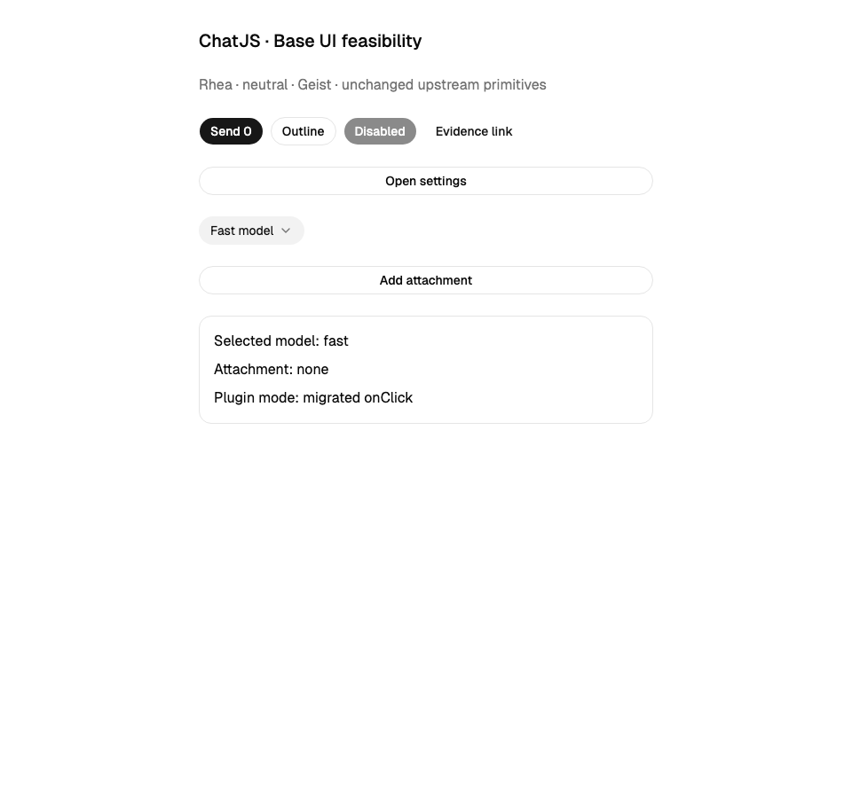
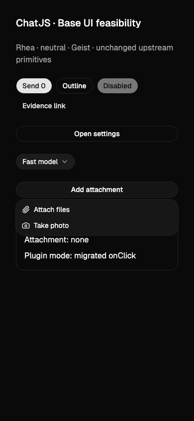
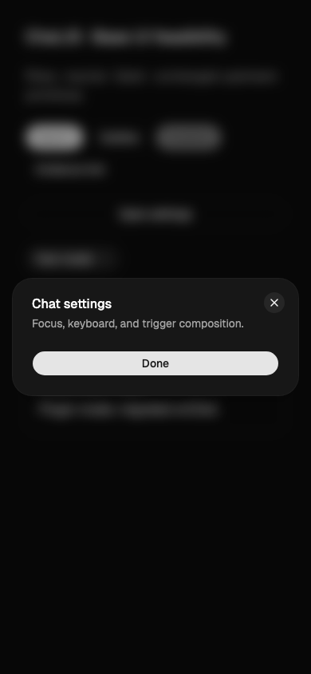

# W0: shadcn chatbot UI baseline

Decision: adopt **Base UI + Rhea** as the W2 target, matching the official chatbot template. Keep the current production app on Radix until each primitive and its callers migrate together. Do not spend a separate phase restyling the app to a temporary Radix baseline. Supporting both libraries remains W9; W0 proves a bounded Base UI migration is feasible, not that a config-only library switch works.

Completed 25 October 2026 against ChatJS `9c7d39254`. No application components or production dependencies were changed by this experiment.

## Recorded upstream inputs

| Input | Observed value |
| --- | --- |
| Official template | [`shadcn-ui/chatbot-template@4106041b1bc9bab44e81ffd2764aa2b6f100e2b0`](https://github.com/shadcn-ui/chatbot-template/tree/4106041b1bc9bab44e81ffd2764aa2b6f100e2b0) |
| Native style | `base-rhea` |
| Theme | `neutral`, CSS variables, no Tailwind prefix |
| Icons / menu | `lucide`, `menuColor: default`, `menuAccent: subtle`, `rtl: false` |
| Fonts | Geist and Geist Mono, configured in `app/layout.tsx` as `--font-sans` and `--font-mono` |
| Tested shadcn CLI | **4.21.0**, matching the repository pin and template dependency; discovery also ran 4.22.1, but it is not required by the result |
| Runtime dependencies in the slice | Base UI 1.8.0, React/React DOM 19.3.0, Tailwind 4.3.1, Lucide 1.48.0 |
| Browser test tooling | Playwright 1.59.1 / Chromium, TypeScript 6.0.2, Vite 7.3.1 |

The pinned CLI successfully installed `button`, `dialog`, `dropdown-menu`, `select`, `message`, `message-scroller`, `bubble`, `attachment`, `trace`, and `code-block` from the standard registry using this configuration. It also installed their dependencies, including `@shadcn/react`. The new chat primitives are therefore available without introducing another registry or upgrading the CLI. Their full runtime integration is W3–W5, not covered by this spike.

Registry responses remain remotely mutable: pinning the CLI and template commit does not pin the live registry's bytes. The reproduction leaves generated source, a Bun lockfile, resolved `shadcn info`, plugin source hash, tests, and screenshots in its output directory for inspection.

The configuration above is the **default reference**, not a new ChatJS theme schema. W1/W6 should pass native shadcn input through to upstream tooling; no ChatJS copies of preset decoding, theme fields, or their validation are implied here.

## Template structure and ownership map

Paths in this table are relative to `apps/chat` unless stated otherwise. Follow the upstream separation of primitives, small app compositions, message parts, hooks, and utilities. The template has no sidebar, authentication, persistence, projects, or EVE orchestration equivalent; those features stay ChatJS-owned.

| Current surface | Target / action | Behavior retained |
| --- | --- | --- |
| `components.json` | Replace legacy `style: default` with the selected native configuration in W2 | Preserve `@chatjs` registry and correct aliases |
| `app/globals.css` | Align standard token blocks and imports; separate editor-specific and application-only rules | Streamdown styling, editor behavior, safe-area/layout requirements |
| `app/layout.tsx`, `components/theme-provider.tsx` | Follow upstream font variables and theme-provider organization | Metadata, Nuqs, Electron and installed layout contributions |
| Upstream `app/typeset.css` | Evaluate as part of Markdown presentation, not a wholesale drop-in | Existing Streamdown code/math/Mermaid output; no duplicate competing typography layer |
| `components/eve/eve-conversation.tsx` and `eve-messages.tsx` | Keep EVE coordination; extract presentation comparable to upstream `components/chat.tsx` and `chat-message.tsx` | Branches, comparisons, optimistic messages, stable identities, recovery, streaming |
| `components/user-message-view.tsx`, `eve/eve-attachment.tsx`, `attachment-list.tsx` | Compose native Message/Bubble/Attachment primitives in W3 | File validation, previews, pending/failure state, removal and download behavior |
| `components/eve/eve-composer.tsx`, composer controls and `ai-elements/prompt-input.tsx` | Template-style `prompt-form` composition around InputGroup in W4 | Lexical, IME, drafts, send/stop, uploads, plugin contributions |
| `components/part/*` | Migrate to `components/parts/*` with consumers as W5 lands | Reasoning, MCP, sources, documents and tool-specific rendering |
| `components/message-actions-view.tsx`, siblings/retry controls | Small app composition comparable to upstream `message-actions.tsx` | Retry, copy, branching/navigation and feedback plugin actions |
| `components/model-selector.tsx`, `eve/eve-model-picker.tsx` | Reuse upstream Select/Combobox primitives where they fit | Model filtering, preferences, comparison selection and availability; the template's simple model list is insufficient |
| `components/app-sidebar.tsx`, settings/auth/projects | Keep app compositions; migrate their shared primitives | Routes, session state, mobile navigation and plugin contributions |
| `packages/registry/src/plugins/*`, `src/tools/*` | Change canonical source and manifests, then regenerate mirrors | Installability, ownership, generated imports and renderer coverage |

The template's `useChat` and `tools/` implementation is not the replacement for ChatJS transport, EVE commands, registry manifests, or provider integration.

## Existing primitive inventory

The current pinned configuration is legacy Radix/zinc. CLI discovery identifies **37 installed shadcn primitives**; this supersedes the earlier planning estimate of 39. Visual fixture files and `ui/extra/action-container.tsx` are not upstream primitives.

| Group | Components | W2 disposition |
| --- | --- | --- |
| Simple presentation and controls | avatar, badge, breadcrumb, button, button-group, card, empty, input, input-group, label, progress, separator, skeleton, spinner, table, textarea | Regenerate from the chosen upstream style; preserve app behavior in compositions, not extra primitive variants |
| Stateful primitives | alert-dialog, checkbox, collapsible, command, dialog, drawer, dropdown-menu, hover-card, popover, resizable, scroll-area, select, sheet, sidebar, slider, switch, tabs, toggle, tooltip | Replace in bounded dependency groups with caller and behavior checks; do not assume API compatibility |
| Legacy form wrapper | form | Replace the MCP form composition using upstream Field/form guidance when that slice migrates; preserve validation and accessible errors |
| No discovered consumer | accordion | Delete after final manifest/scaffold/reference audit, rather than carrying an unused Base equivalent |

Static audit of `.tsx` files found 69 `asChild` occurrences across 32 core component files and 17 across 12 canonical registry files. Core components contain 27 direct Radix import occurrences across 26 files and 11 Radix CSS-variable occurrences across six files; global CSS additionally uses the Radix accordion height variable. Canonical registry source has no direct Radix import or CSS-variable occurrences in this scan, but it depends on Radix component behavior: 12 `onSelect=` occurrences in nine files versus eight in seven core component files. These are search counts, not migration estimates: some `onSelect` handlers belong to Command or custom APIs and must not be changed mechanically.

High-blast-radius components include Button, Dialog, DropdownMenu, Sidebar and Tooltip. Their migration touches auth, navigation, composer controls, projects, sharing, MCP settings and document actions. Update existing primitive/browser captures and affected real-route captures with each slice.

## AI wrapper keep / replace / delete map

All paths below are under `components/ai-elements`. “Delete” means remove after confirming the listed condition and updating tests, not preserve a compatibility export. W0 makes no production deletions.

| File | Decision | Replacement or retained boundary |
| --- | --- | --- |
| `message.tsx` | Replace | Native Message/Bubble plus app-owned branching and action composition; current 564 lines are not an upstream API contract |
| `conversation.tsx` | Replace after scroll parity | Native MessageScroller; preserve history loading, user anchors, branches, comparisons and shared transcript behavior |
| `prompt-input.tsx` | Split, then delete wrapper | Native InputGroup plus ChatJS editor, attachment and control composition; 730 lines mix several responsibilities |
| `actions.tsx` | Replace | Button/Tooltip composition in message actions, retry and siblings controls |
| `reasoning.tsx` | Replace presentation | Trace-based reasoning part; retain stream completion and expansion behavior |
| `tool.tsx`, `extra/mcp-tool-header.tsx` | Replace presentation | Trace and dedicated parts; preserve input, approval, denied, result and error distinctions |
| `response.tsx` | Keep behavior; move with text part | Streamdown with code, math and Mermaid plugins; template react-markdown is not demonstrated equivalent |
| `artifact.tsx` | Keep app-specific composition | EVE artifact/document layout; simplify its visual shell using primitives |
| `sandbox.tsx` | Keep feature-specific composition | Sandbox/terminal behavior; simplify with native tabs/collapsible/code primitives when appropriate |
| `suggestion.tsx` | Replace | Small Button composition in canonical followup-suggestions plugin |
| `shimmer.tsx` | Replace where possible | Upstream shimmer utility; preserve deterministic reduced-motion and streaming status behavior |
| `code-block.tsx` | Delete after lifecycle-test audit | Current imports are browser test fixtures, not a production consumer; production Response uses Streamdown's code plugin. Native CodeBlock can serve future dedicated parts |
| `context.tsx` | Delete after extracting any needed accounting assertions | Current imports are a visual fixture and token-detail tests; no production import discovered. Keep real usage calculation contracts in their domain module |
| `parse-incomplete-markdown.tsx` | Delete with obsolete tests after final reference audit | Only its own test imports it; do not retain a parser that the production renderer does not use |

The “no production consumer” findings cover imports in `apps/chat` and `packages/registry/src`, including relative references checked separately. W2 must also check scaffold assets/manifests before deletion.

## Executed Base UI slice

Run from the repository root:

```sh
bash docs/architecture/experiments/shadcn-base-ui.sh
```

The script creates a new temporary Vite fixture, checks out the exact upstream revision, copies its native configuration/theme, installs pinned tooling through Bun, and generates upstream primitives using shadcn 4.21.0. Dependencies and generated files stay outside the monorepo. It uses port 5197 with `--strictPort` and does not reuse an existing server. Chromium must be installed for Playwright (`bunx playwright install chromium` in the printed experiment directory if needed).

It copies the actual canonical `attachment-uploads/src/controls.tsx` into both an unchanged and migrated fixture. The migrated copy changes only its two `onSelect` callbacks to `onClick`. Session, installed-plugin selection, mobile state, accepted MIME configuration, login prompt and composer callback types are stubbed at their boundaries. File pickers, upload storage/network and real auth are outside this slice.

**Results: six browser tests pass; isolated TypeScript check passes.**

| Check | Observed result |
| --- | --- |
| Button | Click updates state; disabled control stays disabled; semantic anchor retains its link role using `buttonVariants` |
| Dialog | `render` trigger composition opens an accessible titled dialog; Escape closes it and restores trigger focus |
| Select | Controlled value and displayed label agree; pointer and keyboard selection both work with an explicit `items` label map |
| DropdownMenu + unchanged upload plugin | Menu opens and closes, but clicking the original Radix `onSelect` item does **not** invoke `onAttach`; this compiles successfully and fails behaviorally |
| DropdownMenu + migrated upload plugin | `onClick` invokes the original callback for pointer attachment and keyboard camera selection, preserving MIME/capture arguments |
| Plugin gates | Guest gets the login prompt; disabled items remain disabled; desktop hides camera; uninstalled plugin emits no menu items |
| Visual evidence | Reviewed closed controls, open select, open menu and open dialog at desktop/light and mobile/dark; no clipped dialog/menu or missing labels |

Two findings prevent a blind `asChild` replacement:

1. Base Menu selection uses `onClick` for this plugin. React's DOM `onSelect` type permits the old handler to compile while doing nothing on menu activation. The sharing plugin's prevent-default/keep-open behavior also requires an explicit follow-up audit; a global rename is unsafe.
2. Base Button rendered as an anchor still applies a button role. For navigational links, use a real anchor/Next Link with `buttonVariants`, as the [current upstream Button docs](https://ui.shadcn.com/docs/components/base/button#as-link) specify. Use `render` for actual trigger composition. A keyboard/accessibility test caught this during the spike.

The Select sample provides `items` so the closed trigger can resolve labels before the popup mounts. Nullability, group structure and positioning props also differ; the MCP create form must be migrated with its validation tests.

Representative reviewed captures:







The eight images are feasibility evidence, not a comparison against the production app's CI baseline. W2 still owes actual app-route visual diffs and the repository's required checks.

## W2 sequencing and remaining gates

1. Establish the native theme/configuration and font variables with one integration owner. Keep only documented product-specific CSS. The current globals file has 541 lines versus the template's 140, but the template also has 491 lines of separate typeset CSS; raw line reduction is not the acceptance criterion.
2. Migrate simple primitives and their link/caller semantics, then overlay and selection dependency groups. A primitive replacement and all affected callers belong in the same reviewable slice. Avoid a permanent compatibility wrapper that recreates Radix APIs over Base UI.
3. Migrate canonical registry UI with those dependency groups and regenerate mirrors. Run attachment plugin behavior checks, registry coverage, and relevant route captures; the spike's dependency stubs do not verify an installed plugin end to end.
4. Use the existing `primitive-forwarding`, `primitive-overlays`, `assertion-contracts`, `native-boundaries-lifecycle`, `prompt-input-heading`, `speech-lifecycle`, `code-copy`, `code-block-lifecycle`, `reasoning`, `eve-list-identity` and `eve-message-actions` suites to preserve behavior. Extend tests only for gaps that the migration actually creates.
5. Before W3/W4 branch off, verify a second native preset, new standard component installation, and new ChatJS registry installation in the migrated app. Do not advertise preset fields that only change controls but leave application-owned icons/fonts/styles unchanged.

Not proven here: full app Base UI compatibility; sidebar/drawer/Command interactions; all sharing/project/MCP menu semantics; Lexical/Streamdown replacement; MessageScroller branching/history parity; WebKit/mobile keyboard behavior; arbitrary preset parity; either library being selectable during creation. Those are explicit downstream acceptance gates, not reasons to widen the W1 contract.
