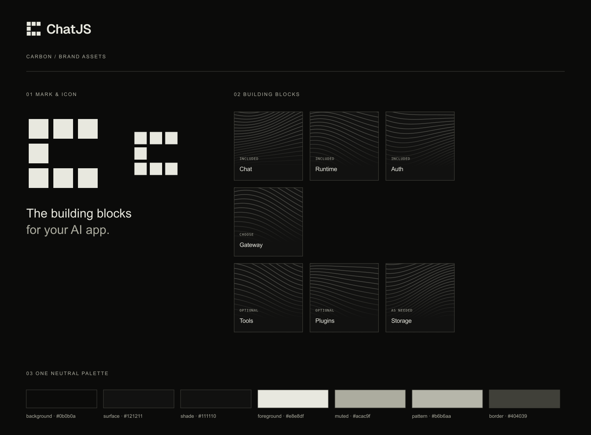

# ChatJS brand

The approved Carbon identity lives here. This is a private, framework-independent workspace package; applications consume the same mark and square renderer rather than maintaining their own drawings.



## Where things go

| Location | Contents | Edit directly? |
| --- | --- | --- |
| `src/identity.ts` | Seven-square C, neutral palette, foundation labels | Yes |
| `src/square.ts` | Carbon wave geometry, square surface, typography and label placement | Yes |
| `src/browser.ts` | Shared runtime for the homepage's two standalone animations | Yes |
| `sources/wordmark.json` | Outlined Geist SemiBold wordmark, independent of installed fonts | Yes |
| `sources/fonts/` | Fonts used in exported squares, with their licenses | Source files |
| `sources/social/` | Approved dark and white wave-banner raster masters | Source files |
| `assets/marks/` | Transparent C in light, dark and `currentColor` | Generated |
| `assets/logos/` | Horizontal C + ChatJS lockups, all vector outlines | Generated |
| `assets/icons/` | App icon, PNGs from 16–1024px, multi-size favicon | Generated |
| `assets/patterns/` | Seven unlabelled vector wave fields | Generated |
| `assets/squares/` | Seven named foundation squares with embedded fonts | Generated |
| `assets/compositions/` | The complete C made from named squares | Generated |
| `assets/product-blocks/` | The 21 approved component-preview SVG masters | Yes |
| `assets/runtime/` | Generated browser bundle for the animations | Generated |
| `assets/social/` | OG (1200 × 630) and GitHub (1280 × 640) banners in dark and white | Generated |
| `assets/overview.svg`, `.png` | Brand contact sheet | Generated |

The contact sheet is an overview, not a screenshot baseline. SVG assets are the resolution-independent masters for marks, icons, and blocks. The approved social composition is stored as raster masters to preserve the selected artwork and typography.

## Generate and check

From the repository root:

```sh
bun brand:generate
bun brand:check
```

Generate after editing a source. Commit both sources and generated exports. Check regenerates in memory and fails if any expected asset or application copy is missing or differs; it does not write files.

The generator updates these application assets:

- `apps/site/public/home/hero/brand.js`, used by both hero and source animations.
- `apps/site/public/home/blocks/`, copied from the component-preview masters.
- `apps/site/public/home/fonts/`, copied from the brand font sources.
- `apps/site/public/logo.svg`, plus the browser icons and social preview in `apps/site/app/`.
- The Chat app mark, browser icons and social preview in `apps/chat/`.
- The Docs wordmarks, favicon, light/dark introduction banners, and introduction social image in `apps/docs/public/`.
- The Electron source icon in `apps/electron/icon.png`. The existing desktop packaging script generates its native formats.
- The Remotion mark in `apps/videos/public/brand/`.

The Site homepage, Threads page and Create UI use the same React mark from `@chatjs/brand/identity`. The Chat and Electron icons are copied assets so a scaffold can ship them without depending on this private workspace.

## Using the assets

- **Light** means light artwork for dark backgrounds; **dark** means dark artwork for light backgrounds.
- Use `currentColor` marks inline. External SVG images do not inherit surrounding text color.
- Keep the C's seven equal squares, two-unit gaps, open center and open right side. Do not put a smaller C inside the first block.
- Use the complete lockup when the audience may not recognize the mark. Give it at least one square's width of clear space.
- Use the app icon for avatars and browser icons; use the transparent mark in layouts.
- Keep individual block wave fields crisp, flat and clipped to their square. The approved social banners extend faint lines beyond the C into the background. No extrusion, puzzle connectors or new per-capability colors.
- Geist is the main typeface; IBM Plex Mono is for metadata. Font licenses are under `sources/fonts/`.
- Labels describe capabilities, not separate products. Product-preview SVGs are illustrations; provider marks embedded in them belong to their respective owners.

For an inline custom square, use `squareSvg(name, metadata, index, uniqueId)` from `@chatjs/brand/square`. Supply a unique gradient ID per SVG in the document. Give the containing control an accessible name; the raw square artwork is decorative.

## Social images and banners

The approved wave composition uses the headline **The building blocks for your AI app**. The dark version is the default social preview for Site, Chat, and the Docs introduction. Docs and the repository README display the matching white version in light mode. Other docs pages retain their page-specific generated cards with the Carbon logo and palette.

The generator center-crops the masters proportionally to each target size without stretching. Social filenames describe the **background** (`dark` or `white`), unlike the transparent-logo naming convention above.

For GitHub's repository social preview, upload [`assets/social/github-dark.png`](assets/social/github-dark.png) under **Settings → General → Social preview**. GitHub stores that image separately; merging a PR updates the README banner but does not update this setting. The [white export](assets/social/github-white.png) is available as an alternative.

## Adding more later

Keep one approved identity here. Add a descriptive asset family such as `assets/social/`, `assets/diagrams/` or `assets/video/`, and put editable inputs in `sources/<family>/`. Extend `scripts/generate.ts` for reproducible exports and application copies. Use names describing purpose, not `final-v2`.

An asset's presence here means it is ready to reuse; it does not imply a new product capability.

For product-preview blocks, add the SVG master in `assets/product-blocks/`, add its actual capability metadata in `apps/site/components/home/blocks.ts`, and run generation plus homepage asset tests. Avoid turning this package into a second registry of product features.
