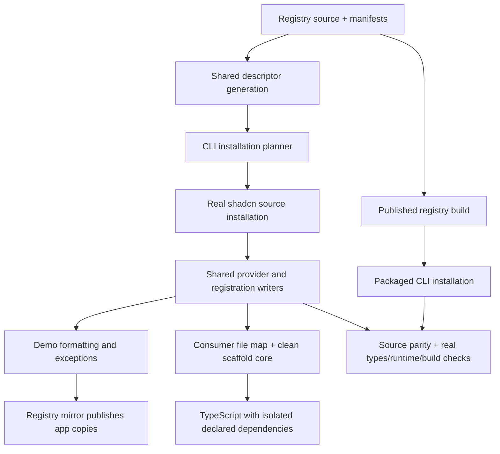

# Registry installation validation

Canonical registry source and manifests drive both development mirroring and consumer validation. The validator does not maintain its own list of plugin files.



## Reusable engine and ChatJS adapter

`packages/registry-validation` owns the isolated compiler, dependency mounting, per-owner source audit, file comparison and local shadcn staging. It has no ChatJS imports. Its tests prepare dependencies outside the workspace and compare a notes registry against the unmodified shadcn CLI. File snapshots are relative-path byte maps, matching the mirror generator interface.

`installation-generator.ts` is the shared ChatJS assembly adapter used by demo mirroring and consumer validation. It supplies the catalog, planner, provider configuration and registration writers to `withRegistryProject`. Core defaults, dependency inheritance, matrix selection and parity exclusions remain ChatJS policy. Changes to the engine invalidate the mirror watch inputs and Turbo checks.

See the [documentation guide](../../apps/docs/registry/validation.mdx). The new package is private to the workspace and is not published.

## Sources of truth

- Registry manifests declare source files, installation targets, dependencies and plugin prerequisites. `descriptor.ts` generates descriptors for both registry publication and local installation. `descriptor-target.ts` also supplies ownership claims.
- The CLI planner resolves the selection and checks its contracts. `installation-generator.ts` uses the real shadcn installer and existing CLI configuration/sync functions. Tool/plugin registration targets are derived from their pure renderers; provider targets are shared with their writers.
- `scaffoldFromTemplate` removes registry-owned copies using manifest claims before initializing the clean consumer core. `validation-project.ts` prepares this core once and overlays each resolved installation. Consumer UI contributions use the CLI's existing UI composition logic; the demo adapter preserves its local order.
- `core-dependencies.ts` explicitly declares the consumer core package names. The real CLI and validator select these names from the normalized app manifest; versions and patched archives remain authoritative there. Optional MCP, observability, document-editor and provider packages are installed only when their selected registry items require them (some editor libraries remain core because shipped shared components use them).
- Registry manifests explicitly declare their own packages. `versionedRegistryItem` resolves bare declarations using the registry package's tested version constraints before publishing or resolving locally. Conflicting selected declarations fail instead of silently choosing one.
- The separate inheritance contract allows registry code to use React, React DOM, Next, AI SDK, EVE, Zod, the AI SDK provider contract, and ChatJS gateway/sandbox contracts. Adding a core dependency does **not** expand that contract. `assertItemDependencies` checks each item's declared source mappings independently during publication and virtual generation: neither core nor a sibling item's declarations can hide a missing package. The negative feedback test removes `drizzle-orm`, which core still uses, and requires rejection.
- `demo-generator.ts` alone applies reference-app formatting and model defaults. The mirror retains its existing publication, ownership and watch behavior.

## Running and coverage

Use Node 24 and the repository Bun installation:

```sh
bun run --cwd packages/registry-validation test:unit
bun run --cwd packages/registry test:installation
bun run --cwd packages/cli test:unit
bun run --cwd packages/registry test:unit
bun run --cwd packages/registry demo:check
bun run --cwd packages/cli test:gateways
```

`test:installation` prepares library builds and the template, then checks 28 cases in the current catalog:

- Five minimal gateways and thirteen individual plugins with declared prerequisite closure.
- A tool/plugin composition with an injected undeclared package regression.
- Seven distinct plugin groups sharing server/client chat hooks, database schemas, routers, settings items, composer controls or layout contributions. Groups come from contribution metadata; identical selections are deduplicated.
- The complete reference installation preset, and that preset with the alternative search provider discovered through the tool slot metadata.

New plugin manifests automatically enter the individual and integration-point groups. Prerequisites expand transitively. This economical matrix exercises shared integration points and the supported full preset; it does not prove every subset, install order, storage SDK or arbitrary third-party registry.

The compiler sees only virtual application files and declared packages from the prepared workspace installation. It cannot recover a missing app file from the reference app or resolve an undeclared direct dependency through workspace hoisting. It checks direct version compatibility and compiler identity. Local package archives supply their actual packed name/version, including npm aliases such as EVE. Negative tests exercise missing sources, undeclared dependencies, incompatible versions, archive identity and compiler configuration.

The packaged plugin selection tests retain exact comparisons of selected plugin files, descriptors and registrations, and additionally compare the complete predicted application inventory against independent packaged CLI installs. Code/CSS formatting is normalized on both sides; generated registrations and other files retain byte comparisons. Package manifests are compared structurally. Only the local fixture URLs for the two packed ChatJS libraries and the `@chatjs` registry endpoint are normalized.

Parity excludes installer receipts (`.chatjs`), package-manager lockfiles, generated framework/build directories, TypeScript incremental state and timestamped database migration history. Existing tests continue checking their behavior. The full-installation sentinel verifies the full preset, repeated sync, database generation, an EVE build and provider replacement against a fresh prediction. Existing Node import, runtime, database, bundling and package-manager/Electron CI checks remain required.

Full-tree parity uncovered and fixed three missing parts of the prediction: managed environment sections, preservation of an existing model catalog, and shadcn import rewriting based on the existing core tree. Environment sections now sort their managed keys so equivalent fresh and replacement installs produce the same output. The renderer therefore supplies real clean-core files as shadcn's project context, preserving its actual transformation behavior.

The real MCP add-after-create test also exposed an incremental Bun installation gap: moving `@ai-sdk/provider-utils` to the root left obsolete nested copies, and TypeScript assigned incompatible schema identities to them. A fresh install of the same lockfile passed. Core now declares the helper directly at the version required by its AI SDK, taking the version from the app manifest like other core dependencies. This keeps its placement stable before adding MCP. It does not expand the plugin inheritance contract. The existing real install-order test protects this behavior; an in-memory check against an already prepared dependency tree cannot establish it.

The CLI Scaffold workflow runs the virtual matrix before its existing gateway and package-manager scaffold tests. The real tests remain required.

## Boundaries and remaining work

- Compilation is in memory. The clean core is constructed once, but its files are materialized as shadcn project context for each selection. No dependency installation occurs per virtual case. See [profiling measurements](VALIDATION-PROFILE.md) for the measured cost and staging decision.
- The dependency fixture must already contain the selected packages. The validator verifies their direct name/version, but does not resolve a fresh lockfile, install lifecycle scripts or check archive bytes against installed bytes. Real installations cover those behaviors.
- Dependency ownership checks static import/export references, literal dynamic imports and requires. Computed runtime loading and optional SDK peer requirements still need authored declarations and runtime tests. The explicit core package contract requires review when core source or executable scripts gain dependencies; it is deliberately not auto-expanded by the validator.
- This adapter supports the local ChatJS source registry with explicit `registry:file` targets. CSS, CSS variables, Tailwind configuration, environment declarations and writes to excluded bootstrap files fail closed. General third-party registries and non-source effects need explicit adapters and parity cases.
- TypeScript does not establish runtime correctness, bundling compatibility, database behavior, browser behavior, native modules or package-manager compatibility. The existing real checks remain essential. Sandbox/provider combinations beyond the representative matrix remain covered by their existing integration tests.
